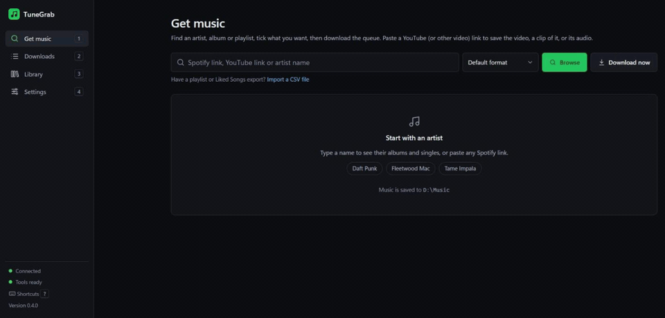
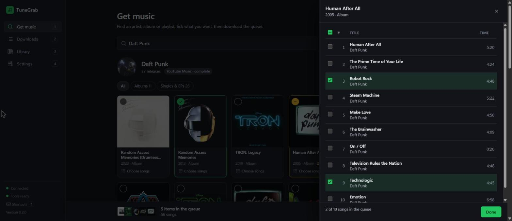
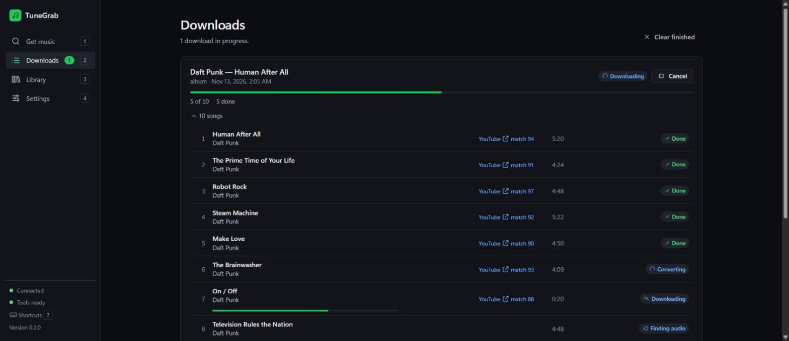
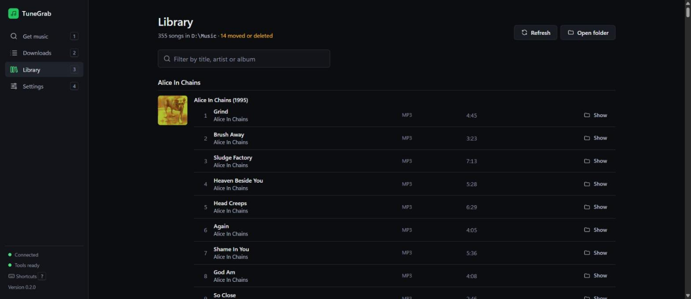
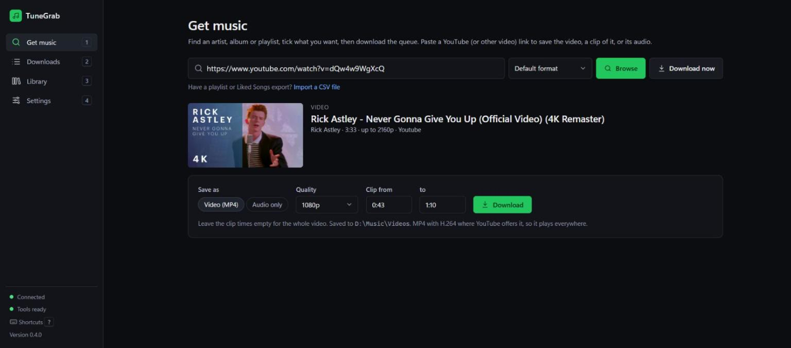
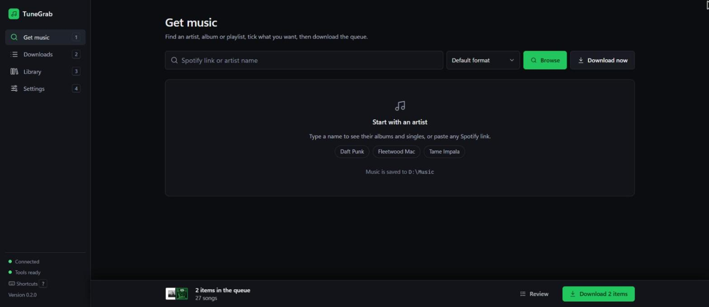
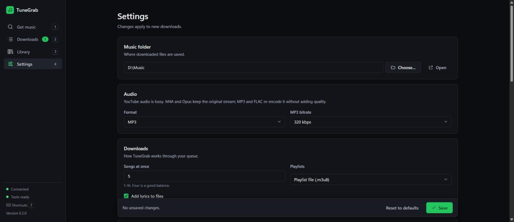

<div align="center">


# TuneGrab

**Pick the albums and songs you want from Spotify, and get a tidy, fully tagged music library on your own drive.**
<br>Plus videos and clips from YouTube and other sites.


[Features](#-features) · [Videos](#-videos-and-clips) · [Install](#-install) · [Using the app](#%EF%B8%8F-using-the-app) · [Command line](#-command-line) · [Settings](#%EF%B8%8F-settings) · [FAQ](#-faq) · [Troubleshooting](#-troubleshooting)



**Windows:** `irm https://raw.githubusercontent.com/HAVEKAUTION/tunegrab/main/install.ps1 | iex` · [other ways](#-install)

</div>

---

## How it works

```
 Spotify link or artist name
          │
          ▼
 ① Resolve   read the track list and details from Spotify (metadata only)
 ② Match     find each song on YouTube Music / YouTube and score the candidates
 ③ Download  fetch the audio with yt-dlp
 ④ Convert   M4A (original audio), Opus, MP3 or FLAC with ffmpeg
 ⑤ Tag       title, artists, album, track no., year, ISRC, cover art, lyrics
 ⑥ Archive   remember it, so it's never downloaded twice
          │
          ▼
 Artist/Album (Year)/01 - Title.m4a
```

Everything runs on your own computer. Spotify is used **only** for track information; the
audio comes from YouTube. TuneGrab never touches Spotify's own audio streams.

Paste a **YouTube (or other video) link** instead and TuneGrab saves the video as an MP4,
just a clip of it, or only its audio.

---

## ✨ Features

<details open>
<summary><b>🔎 Browse before you download</b></summary>

<br>

- Type an artist's name or paste any Spotify **artist, album, playlist or track** link.
- Type anything else, like `Discovery Daft Punk` or `One More Time`, to see matching
  albums and songs from YouTube Music and tick the ones you want.
- See an artist's albums and singles as a cover grid, with **All / Albums / Singles & EPs** filters.
- **Full discography:** Spotify's public page lists only the newest 8 albums and 8 singles,
  so TuneGrab loads the complete list from YouTube Music.
- Click a cover to queue the whole release, or **Choose songs** to tick individual tracks.



</details>

<details>
<summary><b>🧺 One queue for everything</b></summary>

<br>

- Collect albums, songs and playlists from as many artists as you like into one queue.
- **Import a CSV** of a playlist or your Liked Songs (for example from
  [Exportify](https://exportify.app)). No Spotify login needed.
- The queue is kept if you close the page or restart your PC.
- **Review** shows everything queued; remove items or clear the lot, with **Undo**.
- **Download** (or `Ctrl+Enter`) starts the whole queue in one go.

</details>

<details>
<summary><b>⬇️ Live downloads you can trust</b></summary>

<br>

- Live progress for every song: finding audio → downloading → converting → done.
- Each song links to the YouTube video it used, with a **match score** (0–100) and the reason.
- Several songs download at once (you choose how many).
- Anything already in your library is skipped, so it's safe to stop and start again.
- Shows the source each song was made from (e.g. *Opus 129 kbps*). Unavailable videos fall
  back to the next-best match, and a YouTube "slow down" pauses the queue instead of failing it.
- Failed songs show why. **Retry failed songs** works even after a restart.
- TuneGrab couldn't find a song? Press **Use a YouTube link** next to it, paste the right
  video and it downloads that one, and remembers it for next time.
- Download history is kept between sessions.



</details>

<details>
<summary><b>🏷️ Properly tagged files</b></summary>

<br>

- Title, artists, album, album artist, track and disc number, year, ISRC and genre where available.
- Embedded **cover art**.
- **Lyrics** from LRCLIB (free, no account), embedded in the file, plus an optional synced `.lrc` file.
- **M4A** by default: YouTube's original audio, not re-encoded. Or **Opus**, **MP3**
  (VBR V0 or 128–320 kbps) or **FLAC**.
- Windows-safe file names, with your own naming pattern if you want one.
- Playlists also get an `.m3u8` playlist file (or their own folder).

</details>

<details>
<summary><b>🎯 Smart matching</b></summary>

<br>

- Searches YouTube Music first (official audio), then regular YouTube.
- Scores every candidate on title, artist, duration and album, and penalises live,
  cover, karaoke, sped-up, remix, extended, acoustic and demo versions you didn't ask for.
- Official music videos aren't thrown out just because their intro makes them longer.
- Titles are compared as written in any script (Japanese, Korean, Cyrillic, ...); only
  Latin accents are folded (Beyoncé = Beyonce).
- When two results score the same, YouTube's own ranking decides.
- Songs that score below the threshold (default 70) are flagged instead of downloaded wrongly.
- A match TuneGrab isn't sure about (score under 85, or a "live" / "remix" / "cover" video for
  a plain song) is downloaded but marked **Check this match**: open it to compare the other
  candidates, listen, and swap with one click. The old file is replaced only once the new
  one is ready.
- Fix a bad match once (**Check this match** or **Use a YouTube link** in the app, or
  `tunegrab fix`) and TuneGrab remembers it.

</details>

<details>
<summary><b>📚 Library</b></summary>

<br>

- Everything you've downloaded, grouped by artist and album, with covers.
- Instant filter by title, artist or album (fast even with thousands of songs).
- **Show** opens a song's folder; flags files you've moved or deleted.
- Each song shows what YouTube actually served ("MP3 · from Opus 129 kbps") and is marked
  when only a low-quality source existed.
- **Check for new songs** on a playlist downloads what was added and lists what left it.
  Files of songs that left are deleted only if you tick them and confirm a list of every
  file; songs another playlist still has are never deleted. For a CSV playlist, pick a newer
  export of it.



</details>

<details>
<summary><b>🛡️ Private and safe by design</b></summary>

<br>

- Runs only on your PC and listens only on `127.0.0.1`. Other websites can't talk to it.
- No accounts, tracking, ads or crash reporting.
- Optional Spotify credentials are kept in a git-ignored `.env` file or your system keyring.
- Never decrypts Spotify audio.

</details>

<details>
<summary><b>⌨️ Keyboard friendly</b></summary>

<br>

| Key | Does |
|---|---|
| `/` | Jump to search |
| `1` `2` `3` `4` | Get music · Downloads · Library · Settings |
| `Space` | Tick the focused cover or song |
| `Ctrl+Enter` | Download the queue |
| `Esc` | Close a panel or dialog |
| `?` | Show all shortcuts |

</details>

---

## 🎬 Videos and clips

Paste a **YouTube** link (or one from any
[site yt-dlp supports](https://github.com/yt-dlp/yt-dlp/blob/master/supportedsites.md))
into **Get music** and press **Browse**. Save it as an **MP4** (up to 4K), as **audio only**,
or just a **clip** between two times. Playlists download every video.



---

## 📦 Install

TuneGrab needs three free tools: **uv** (runs Python for you), **ffmpeg** (audio conversion)
and **Deno** (YouTube needs it).

<details open>
<summary><b>🪟 Windows (recommended: about 5 minutes)</b></summary>

<br>

Open PowerShell and paste:

```powershell
irm https://raw.githubusercontent.com/HAVEKAUTION/tunegrab/main/install.ps1 | iex
```

It installs uv, ffmpeg and Deno if they're missing (with winget), puts the latest release in
`%LOCALAPPDATA%\Programs\TuneGrab`, adds TuneGrab to the Start menu and desktop, and opens it.
Run the same line again to update. [Read the script](install.ps1) first if you like: it's short.

<details>
<summary>Install by hand instead</summary>

1. `winget install astral-sh.uv Gyan.FFmpeg DenoLand.Deno`, then reopen PowerShell.
2. `git clone https://github.com/HAVEKAUTION/tunegrab.git` (or **Code → Download ZIP**).
3. Double-click **`TuneGrab.bat`**. The first start takes about a minute.

</details>

> Keep the black launcher window open while you use TuneGrab: closing it stops TuneGrab.
> Opening the launcher again while TuneGrab is running just reopens the page.

</details>

<details>
<summary><b>🍎 macOS</b></summary>

<br>

```bash
brew install uv ffmpeg deno
git clone https://github.com/HAVEKAUTION/tunegrab.git
cd tunegrab
uv sync --no-dev                    # the app only, without developer tools
uv run --no-dev tunegrab serve      # opens http://127.0.0.1:8765 in your browser
```

</details>

<details>
<summary><b>🐧 Linux</b></summary>

<br>

```bash
curl -LsSf https://astral.sh/uv/install.sh | sh     # uv
sudo apt install ffmpeg                             # or your distro's package manager
curl -fsSL https://deno.land/install.sh | sh        # Deno
git clone https://github.com/HAVEKAUTION/tunegrab.git
cd tunegrab
uv sync --no-dev
uv run --no-dev tunegrab serve
```

</details>

<details>
<summary><b>✅ Check everything is ready</b></summary>

<br>

In the app, open **Settings → System**: every row should be green. Or from a terminal:

```powershell
uv run tunegrab doctor
```

It checks Python, ffmpeg, Deno (or Node.js 22+ / Bun / QuickJS), yt-dlp (warning when
it's out of date), your music folder and any Spotify credentials, and says what to fix.

</details>

<details>
<summary><b>💻 Install the command globally (optional)</b></summary>

<br>

To type `tunegrab` from any folder instead of `uv run tunegrab`:

```powershell
uv tool install .
```

Stop TuneGrab first if it's running (Windows locks the program file while it runs).

</details>

<details>
<summary><b>🔄 Updating</b></summary>

<br>

```powershell
git pull                          # get the latest TuneGrab
uv run tunegrab doctor --update   # update yt-dlp (do this whenever YouTube downloads start failing)
```

Or in the app: **Settings → System → Update yt-dlp**, then restart TuneGrab. The launcher
re-syncs everything else by itself on the next start. The app tells you when a new TuneGrab
or yt-dlp is out (checked once a day; **Settings → Updates** turns it off).

</details>

<details>
<summary><b>🧹 Disk space and uninstalling</b></summary>

<br>

Besides your music, TuneGrab keeps the app folder (about 50 MB) and its settings, history
and logs in `%LOCALAPPDATA%\tunegrab` (a few MB). **Settings → Storage → Free up space**
(or `tunegrab clean`) clears leftovers; `tunegrab clean --uv-cache` also prunes uv's shared
package cache. Your music, settings and history stay.

**Uninstall** (installed with the one-liner):

```powershell
& ([scriptblock]::Create((irm https://raw.githubusercontent.com/HAVEKAUTION/tunegrab/main/install.ps1))) -Uninstall
```

Otherwise delete the `tunegrab` folder. Settings and history live in
`%LOCALAPPDATA%\tunegrab` (on macOS
`~/Library/Application Support/tunegrab` and `~/Library/Logs/tunegrab`; on Linux
`~/.config/tunegrab`, `~/.local/share/tunegrab` and `~/.local/state/tunegrab`); delete
those too if you want them gone. Your music folder is never touched.

</details>

---

## 🖱️ Using the app



<details open>
<summary><b>Download a few albums from an artist</b></summary>

<br>

1. On **Get music**, type the artist's name (or paste their Spotify link) and press **Enter**.
2. Click **Full discography** if you want more than the newest releases.
3. Click the covers you want; a green tick shows they're queued. Use **Choose songs** to pick
   individual tracks from a release.
4. Repeat for as many artists as you like. The queue bar at the bottom keeps a running total.
5. Press **Download** (or `Ctrl+Enter`) and watch progress on **Downloads**.

</details>

<details>
<summary><b>Download a playlist, album or single song</b></summary>

<br>

Paste the Spotify link into **Get music** and press **Download now** to skip the preview, or
**Browse** to see and pick the tracks first. For one song you can also type its title
(or `Artist - Title`) and press **Browse** to pick it from the results, or **Download now**.

</details>

<details>
<summary><b>Download a video, a clip of one, or just its audio</b></summary>

<br>

1. Paste the link into **Get music** and press **Browse**.
2. Pick **Video (MP4)** and a quality, or **Audio only**. For a clip, fill in **Clip from**
   and **to** (`1:23`, `83` or `1:02:03`).
3. Press **Download**. Videos go to `Videos/Channel/Title [id].mp4` in your music folder.

**Download now** on a video link saves just its audio into your music folder.

</details>

<details>
<summary><b>Download your Liked Songs (or any playlist) from a CSV</b></summary>

<br>

1. Go to [exportify.app](https://exportify.app), log in with Spotify and press **Export**
   next to *Liked Songs* (or any playlist). You get a `.csv` file.
2. In TuneGrab, under the search box on **Get music**, click **Import a CSV file** and pick it.
3. Everything downloads as one playlist named after the file, with its own `.m3u8`.

Any CSV with **Track Name** and **Artist Name(s)** columns works (commas, semicolons or tabs),
and so does a single **Track URI** column of Spotify links. From a terminal:
`tunegrab download --from-file Liked_Songs.csv`.

</details>

<details>
<summary><b>Fix failed or wrong songs</b></summary>

<br>

- **Failed:** open **Downloads** and press **Retry failed songs**. Each failure shows its reason.
- **Not found at all:** press **Use a YouTube link** under the failed song, paste the right
  video (there's a search link right in the dialog) and press **Download this one**.
- **Wrong version downloaded:** songs TuneGrab had doubts about show **Check this match** in
  Downloads and Library; pick another candidate there. For any other song, run
  `tunegrab match <spotify-link>` to see the scores, then
  `tunegrab fix <spotify-track-link> <youtube-link>` to force the right video. TuneGrab
  remembers the fix for next time.

</details>

<details>
<summary><b>Change where music is saved and how it's named</b></summary>

<br>

Music is saved to **Music\TuneGrab** in your user folder unless you pick another one.
(If you used TuneGrab 0.4 or older, it keeps using the `downloads` folder it used before.)
**Settings → Music folder → Choose…** opens a folder picker. Press **Save**. File naming,
format, quality, lyrics and how many songs download at once are on the same screen.



</details>

---

## 💻 Command line

Everything in the app is also available from a terminal (prefix with `uv run` unless you
installed it globally).

```powershell
tunegrab get "Daft Punk - One More Time"                        # one song, best match
tunegrab download https://open.spotify.com/album/2noRn2Aes5aoNVsU6iWThc
tunegrab download <playlist-url> -f m4a -o D:\Music             # choose format and folder
tunegrab download --from-file my-links.txt                      # one link per line
tunegrab download --from-file Liked_Songs.csv                   # an Exportify CSV
tunegrab video https://youtu.be/dQw4w9WgXcQ                     # the video, as MP4 (1080p)
tunegrab video <link> --start 0:43 --end 1:10 -q 720            # just a clip
tunegrab video <link> --audio -f opus                           # only the audio
tunegrab serve                                                  # start the app
```

<details>
<summary><b>All commands</b></summary>

<br>

| Command | What it does |
|---|---|
| `download <url-or-query>... [--from-file list.txt]` | The main command. Accepts several inputs; `--from-file` reads one per line (`#` comments OK), or a `.csv` export (Exportify etc.). Options: `-f/--format mp3\|m4a\|opus\|flac`, `-b/--bitrate`, `-o/--out`, `-t/--threads`, `--lyrics/--no-lyrics`, `--lrc` (synced `.lrc` file), `--playlist-mode m3u\|folder`. |
| `get "artist - title"` | Download the top search result. |
| `video <link>` | Download a video (MP4) from YouTube or another yt-dlp site, or a playlist of them. `--audio` for only the audio (`-f` format), `-q/--quality best\|2160\|1440\|1080\|720\|480\|360`, `-s/--start` and `-e/--end` for a clip, `-o/--out` for the folder. |
| `search "query"` | Show results and pick one interactively. |
| `info <url>` | List the tracks behind a link without downloading. |
| `match <url> [--threshold N] [--no-cache]` | Dry run: which YouTube video each track would use, its score and why. |
| `sync <playlist-url> [--remove] [--yes]` | Download new tracks in a playlist. Lists tracks that left it; `--remove` deletes them (asks first, keeps files used by another playlist). |
| `fix <spotify-track-url> <youtube-url-or-id>` | Override a wrong match, remember it and re-download (`--no-download` to only save the override). |
| `retry [--clear]` | Re-run every track that failed before, or forget them with `--clear`. |
| `status` | Library and archive statistics, plus open failures. |
| `config show \| set <key> <value> \| unset <key> \| path` | View or change settings (`set <key> none` resets one). |
| `login` / `logout` | Optional Spotify login for private playlists and Liked Songs. |
| `serve [--host] [--port] [--no-open]` | Start the app on `127.0.0.1:8765`. |
| `doctor [--update]` | Check everything is installed; `--update` upgrades yt-dlp. |
| `clean [--dry-run] [--uv-cache]` | Show what TuneGrab keeps on disk and free space (unfinished downloads, old logs, yt-dlp cache, compact the history). Never touches your music. |

Global flags: `--version`, `-v/--verbose` (logs always go to a rotating file too).

</details>

---

## ⚙️ Settings

<details>
<summary><b>Where settings come from</b></summary>

<br>

From highest to lowest priority: **command-line flags → `TUNEGRAB_*` environment variables →
`.env` → system keyring → config file → defaults.** Run `tunegrab config show` to see every
setting and where its value came from.

| Setting | Default | Meaning |
|---|---|---|
| `output_dir` | `~/Music/TuneGrab` | Music folder (installs from 0.4.x keep their `downloads` folder) |
| `format` | `m4a` | `m4a`, `opus`, `mp3` or `flac`. Profiles from before 0.5 keep `mp3` |
| `bitrate` | — (V0) | MP3 only: unset is LAME VBR V0 (about 245 kbps); a number is constant kbps |
| `threads` | `4` | Songs downloaded at once (1–16) |
| `lyrics` / `lrc` | on / off | Embed lyrics / also write a synced `.lrc` |
| `playlist_mode` | `m3u` | `m3u` playlist file, or `folder` per playlist |
| `match_threshold` | `70` | Minimum match score (0–100) |
| `cookies_from_browser` | — (off) | `firefox`, `chrome`, `edge`, …: YouTube sign-in for age-restricted videos. YouTube can restrict the account used |
| `video_quality` | `1080` | Highest video resolution: `best`, `2160` … `360` |
| `check_updates` | `true` | Once a day, ask GitHub and PyPI whether a newer TuneGrab or yt-dlp is out |
| `video_dir` | `<music folder>/Videos` | Where videos are saved |
| `track_template` | see below | File naming pattern |

</details>

<details>
<summary><b>File naming patterns</b></summary>

<br>

Default: `{album_artist}/{album} ({year})/{track_number:02d} - {title}.{ext}`

Available fields: `{title} {artist} {artists} {album} {album_artist} {year} {date}
{track_number} {disc_number} {total_tracks} {playlist} {position} {isrc} {ext}`

</details>

<details>
<summary><b>Spotify developer credentials (optional)</b></summary>

<br>

Without credentials TuneGrab reads Spotify's public pages. That covers tracks, albums and
playlists, with two limits: **playlists stop at the first 100 tracks** (you get a warning
with the real count) and **artist links give their top 10 tracks** (use the app's artist
browser or **Full discography** for everything).

To lift those limits:

1. Create an app at [developer.spotify.com/dashboard](https://developer.spotify.com/dashboard)
   (Development Mode needs the app owner to have **Spotify Premium**). Redirect URI:
   `http://127.0.0.1:8888/callback`.
2. Copy `.env.example` to `.env` and fill in `SPOTIFY_CLIENT_ID` and `SPOTIFY_CLIENT_SECRET`,
   or run `tunegrab config set spotify_client_secret ...` to store it in the system keyring.
3. Run `tunegrab login` once if you also want private playlists or Liked Songs.

Full walkthrough: [`docs/SETUP.md`](docs/SETUP.md).

</details>

---

## ❓ FAQ

<details>
<summary><b>Do I need a Spotify account or Premium?</b></summary>

<br>

No. Public links and artist names work with no account. Premium is only needed if you
want to create your own Spotify developer app (see [Settings](#%EF%B8%8F-settings)).

</details>

<details>
<summary><b>Can I download my Liked Songs?</b></summary>

<br>

Yes. Export them with [Exportify](https://exportify.app) and use **Import a CSV file** on
**Get music**. TuneGrab reads the song details straight from the file, so it doesn't need
your Spotify login.

</details>

<details>
<summary><b>What audio quality do I get?</b></summary>

<br>

YouTube audio is lossy (typically around 128–160 kbps Opus/AAC; 256 kbps with YouTube Premium
and **Settings → YouTube sign-in**). **M4A** (the default) and **Opus** keep the original
stream untouched; M4A plays on phones, cars and Windows, Opus makes the smallest files.
**MP3** and **FLAC** re-encode it for old players, but can't add quality that isn't there.
MP3 uses VBR V0 unless you pick a bitrate: it sounds the same as 320 kbps for YouTube audio
and is smaller. If you used TuneGrab before 0.5, it stays on MP3 until you change it.

TuneGrab skips YouTube's volume-levelled "stable volume" copy, retries when YouTube only
offers a low-quality one, and flags any song that had to settle for it.

</details>

<details>
<summary><b>What video quality do I get?</b></summary>

<br>

The best available up to the quality you pick (1080p by default), as H.264 + AAC MP4 that
plays anywhere. Above 1080p YouTube only offers VP9/AV1. AI-upscaled copies are skipped.

</details>

<details>
<summary><b>Will it download the same song twice?</b></summary>

<br>

No. Every download is recorded in a small database, and anything already in your library is
skipped. Re-running a big job only fetches what's missing.

</details>

<details>
<summary><b>Can I close the browser tab?</b></summary>

<br>

Yes. Downloads keep running as long as the launcher window is open. Reopen
`http://127.0.0.1:8765` (or double-click the launcher again) to check progress.

</details>

<details>
<summary><b>What data leaves my computer?</b></summary>

<br>

Only requests to Spotify (track information), YouTube / YouTube Music (search and audio),
LRCLIB (lyrics) and the image servers for cover art. Once a day TuneGrab also asks GitHub
and PyPI for the newest TuneGrab and yt-dlp version numbers (turn it off in
**Settings → Updates**, or `tunegrab config set check_updates false`); nothing about you or
your music is sent. There's no tracking or crash reporting. Logs stay on your PC
(**Settings → About** shows where).

</details>

<details>
<summary><b>Is this legal?</b></summary>

<br>

It depends where you live. In Australia, downloading copyrighted music from YouTube without
permission isn't covered by the format-shifting exception (which only applies to recordings
you already legitimately own), and it's against YouTube's terms. Lots of people do it for
personal use, but it's your call. The same goes for videos: only download ones you're
allowed to. TuneGrab deliberately **does not** decrypt Spotify audio.

</details>

<details>
<summary><b>Isn't there already a tool like this?</b></summary>

<br>

Yes: [spotDL](https://github.com/spotDL/spotify-downloader) is free, open source and works the
same way. TuneGrab focuses on a visual "browse, tick and queue" app, and on picking a whole
discography across several artists in one go.

</details>

---

## 🧰 Troubleshooting

<details>
<summary><b>YouTube downloads suddenly all fail</b></summary>

<br>

YouTube changes often and yt-dlp keeps up. In the app: **Settings → System → Update
yt-dlp**, then restart TuneGrab. Or from a terminal:

```powershell
uv run tunegrab doctor --update
```

Also check Deno is installed (`deno --version`).

</details>

<details>
<summary><b>"Sign in to confirm you're not a bot"</b></summary>

<br>

YouTube limits how many videos one connection can fetch (roughly 300 an hour without
signing in). TuneGrab stays under that: big jobs start at full speed, then slow to about 250
songs an hour. If YouTube still says "slow down", TuneGrab waits a minute, then two; the
third time in a job it pauses for an hour (YouTube's block lasts about that long) and shows
when it will continue, with a **Try now** button. After five it stops and leaves the songs
for **Retry**.

If it keeps happening, turn off any VPN. Signing in raises the limit, but YouTube can
restrict the Google account used, so only do it with an account you can afford to lose
access to: in **Settings → YouTube sign-in**, choose the browser you use YouTube in (Firefox
works best; on Windows, Chromium browsers usually have to be closed and may not be readable).
The same setting lets you download age-restricted videos. From the command line:

```powershell
uv run tunegrab config set cookies_from_browser firefox
```

</details>

<details>
<summary><b>The launcher closes straight away or says "uv" is missing</b></summary>

<br>

Install uv (`winget install astral-sh.uv`), then reopen the launcher. If you moved the
TuneGrab folder, the launcher rebuilds its environment automatically; just wait for
"Setting up TuneGrab...".

</details>

<details>
<summary><b>"Port 8765 is already used by another program"</b></summary>

<br>

Something else is using that port. Start on another one:

```powershell
uv run tunegrab serve --port 8766
```

</details>

<details>
<summary><b>A song matched the wrong version</b></summary>

<br>

If the song shows **Check this match** (Downloads or Library), open it and press **Use this
one** on the right video. Otherwise:

```powershell
uv run tunegrab match <spotify-link>                       # see the scores
uv run tunegrab fix <spotify-track-link> <youtube-link>    # force the right one
```

</details>

<details>
<summary><b>A playlist stops at 100 songs</b></summary>

<br>

That's the limit of Spotify's public pages. Add Spotify developer credentials (see
[Settings](#%EF%B8%8F-settings)) to get the full playlist.

</details>

<details>
<summary><b>Where are the logs?</b></summary>

<br>

**Settings → About** shows the log file path with a copy button. Run any command with `-v` to
also see details in the terminal.

</details>

---

## 🛠️ For developers

<details>
<summary><b>Project layout, tests and tooling</b></summary>

<br>

Python 3.11+, managed with **uv**. Typer + Rich (CLI), httpx, pydantic, FastAPI (local app),
ytmusicapi + rapidfuzz (matching), yt-dlp, mutagen, SQLite.

```powershell
uv sync                         # install everything, including the developer tools
uv run pytest -q                # unit tests (network mocked)
uv run pytest -m live -q        # real-network smoke tests
uv run ruff check --fix . ; uv run ruff format . ; uv run mypy src
uv run python scripts/check_design.py   # UI colour-contrast check
```

| Path | What's there |
|---|---|
| `src/tunegrab/metadata/` | Spotify Web API and public-page providers |
| `src/tunegrab/matching/` | YouTube Music / YouTube search and scoring |
| `src/tunegrab/download/`, `tagging/` | yt-dlp (with YouTube workarounds), ffmpeg and mutagen |
| `src/tunegrab/video.py` | Video, clip and audio-from-video downloads |
| `src/tunegrab/storage.py` | Disk usage report and `tunegrab clean` |
| `src/tunegrab/library/` | SQLite archive, history, overrides |
| `src/tunegrab/web/` | FastAPI app and the single-page UI |
| `docs/ARCHITECTURE.md` | Design |

Changes per version: [`CHANGELOG.md`](CHANGELOG.md).

</details>

---

## 📌 Project status

TuneGrab is a personal project, shared as-is. I fix what breaks for my own use and push those
fixes here, but I don't take feature requests or offer support. Forks are welcome.

---

## 📄 License

TuneGrab is free software under the [GNU General Public License v3.0 or later](LICENSE).
You can use, change and share it; if you share a changed version, it must stay under the same licence.

TuneGrab builds on [yt-dlp](https://github.com/yt-dlp/yt-dlp),
[ytmusicapi](https://github.com/sigma67/ytmusicapi), [mutagen](https://github.com/quodlibet/mutagen),
[LRCLIB](https://lrclib.net) and other open-source projects. It is not affiliated with Spotify or YouTube.
Use it only for music you're allowed to download where you live.
