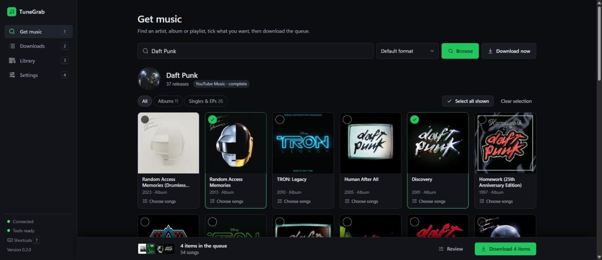

<div align="center">

# 🎵 TuneGrab

**Pick the albums and songs you want from Spotify, and get a tidy, fully tagged music library on your own drive.**


[Features](#-features) · [Install](#-install) · [Using the app](#%EF%B8%8F-using-the-app) · [Command line](#-command-line) · [Settings](#%EF%B8%8F-settings) · [FAQ](#-faq) · [Troubleshooting](#-troubleshooting)



</div>

---

## How it works

```
 Spotify link or artist name
          │
          ▼
 ① Resolve   read the track list and details from Spotify (metadata only)
 ② Match     find each song on YouTube Music / YouTube and score the candidates
 ③ Download  fetch the audio with yt-dlp
 ④ Convert   MP3, M4A, Opus or FLAC with ffmpeg
 ⑤ Tag       title, artists, album, track no., year, ISRC, cover art, lyrics
 ⑥ Archive   remember it, so it's never downloaded twice
          │
          ▼
 Artist/Album (Year)/01 - Title.mp3
```

Everything runs on your own computer. Spotify is used **only** for track information; the
audio comes from YouTube. TuneGrab never touches Spotify's own audio streams.

---

## ✨ Features

<details open>
<summary><b>🔎 Browse before you download</b></summary>

<br>

- Type an artist's name or paste any Spotify **artist, album, playlist or track** link.
- See an artist's albums and singles as a cover grid, with **All / Albums / Singles & EPs** filters.
- **Full discography:** Spotify's public page lists only the newest 8 albums and 8 singles,
  so TuneGrab loads the complete list from YouTube Music.
- Click a cover to queue the whole release, or **Choose songs** to tick individual tracks.


</details>

<details>
<summary><b>🧺 One queue for everything</b></summary>

<br>

- Collect albums, songs and playlists from as many artists as you like into one queue.
- **Import a CSV** of a playlist or your Liked Songs (for example from
  [Exportify](https://exportify.app)). No Spotify login needed.
- The queue is kept if you close the page or restart your PC.
- **Review** shows everything queued; remove items or clear the lot, with **Undo**.
- **Download** (or `Ctrl+Enter`) starts the whole queue in one go.

</details>

<details>
<summary><b>⬇️ Live downloads you can trust</b></summary>

<br>

- Live progress for every song: finding audio → downloading → converting → done.
- Each song links to the YouTube video it used, with a **match score** (0–100) and the reason.
- Several songs download at once (you choose how many).
- Anything already in your library is skipped, so it's safe to stop and start again.
- Failed songs show why. **Retry failed songs** works even after a restart.
- TuneGrab couldn't find a song? Press **Use a YouTube link** next to it, paste the right
  video and it downloads that one, and remembers it for next time.
- Download history is kept between sessions.


</details>

<details>
<summary><b>🏷️ Properly tagged files</b></summary>

<br>

- Title, artists, album, album artist, track and disc number, year, ISRC and genre where available.
- Embedded **cover art**.
- **Lyrics** from LRCLIB (free, no account), embedded in the file, plus an optional synced `.lrc` file.
- Choose **MP3** (128–320 kbps), **M4A**, **Opus** or **FLAC**.
- Windows-safe file names, with your own naming pattern if you want one.
- Playlists also get an `.m3u8` playlist file (or their own folder).

</details>

<details>
<summary><b>🎯 Smart matching</b></summary>

<br>

- Searches YouTube Music first (official audio), then regular YouTube.
- Scores every candidate on title, artist, duration and album, and penalises live,
  cover, karaoke, sped-up, remix, extended, acoustic and demo versions you didn't ask for.
- Official music videos aren't thrown out just because their intro makes them longer.
- Titles are compared as written in any script (Japanese, Korean, Cyrillic, ...); only
  Latin accents are folded (Beyoncé = Beyonce).
- When two results score the same, YouTube's own ranking decides.
- Songs that score below the threshold (default 70) are flagged instead of downloaded wrongly.
- Fix a bad match once (**Use a YouTube link** in the app, or `tunegrab fix`) and
  TuneGrab remembers it.

</details>

<details>
<summary><b>📚 Library</b></summary>

<br>

- Everything you've downloaded, grouped by artist and album, with covers.
- Instant filter by title, artist or album (fast even with thousands of songs).
- **Show** opens a song's folder; flags files you've moved or deleted.


</details>

<details>
<summary><b>🛡️ Private and safe by design</b></summary>

<br>

- Runs only on your PC and listens only on `127.0.0.1`. Other websites can't talk to it.
- No accounts, tracking, ads or crash reporting.
- Optional Spotify credentials are kept in a git-ignored `.env` file or your system keyring.
- Never decrypts Spotify audio.

</details>

<details>
<summary><b>⌨️ Keyboard friendly</b></summary>

<br>

| Key | Does |
|---|---|
| `/` | Jump to search |
| `1` `2` `3` `4` | Get music · Downloads · Library · Settings |
| `Space` | Tick the focused cover or song |
| `Ctrl+Enter` | Download the queue |
| `Esc` | Close a panel or dialog |
| `?` | Show all shortcuts |

</details>

---

## 📦 Install

TuneGrab needs three free tools: **uv** (runs Python for you), **ffmpeg** (audio conversion)
and **Deno** (YouTube needs it).

<details open>
<summary><b>🪟 Windows (recommended: about 5 minutes)</b></summary>

<br>

**1. Install the tools.** Open PowerShell and run:

```powershell
winget install astral-sh.uv Gyan.FFmpeg DenoLand.Deno
```

Close and reopen PowerShell afterwards so the new tools are found.

**2. Get TuneGrab.**

```powershell
git clone https://github.com/HAVEKAUTION/tunegrab.git
cd tunegrab
```

(Or click **Code → Download ZIP** on GitHub and unzip it anywhere.)

**3. Start it.** Double-click **`TuneGrab.bat`**.

The first start takes about a minute while it sets itself up; after that it opens in a couple
of seconds. Your browser opens on TuneGrab automatically.

**4. (Optional) Desktop shortcut.** Right-click `TuneGrab.bat` → **Show more options → Send to →
Desktop (create shortcut)**. To start with Windows, put a shortcut in the folder that opens
when you type `shell:startup` in the Run box (`Win+R`).

> Keep the black launcher window open while you use TuneGrab: closing it stops TuneGrab.
> Opening the launcher again while TuneGrab is running just reopens the page.

</details>

<details>
<summary><b>🍎 macOS</b></summary>

<br>

```bash
brew install uv ffmpeg deno
git clone https://github.com/HAVEKAUTION/tunegrab.git
cd tunegrab
uv sync
uv run tunegrab serve        # opens http://127.0.0.1:8765 in your browser
```

</details>

<details>
<summary><b>🐧 Linux</b></summary>

<br>

```bash
curl -LsSf https://astral.sh/uv/install.sh | sh     # uv
sudo apt install ffmpeg                             # or your distro's package manager
curl -fsSL https://deno.land/install.sh | sh        # Deno
git clone https://github.com/HAVEKAUTION/tunegrab.git
cd tunegrab
uv sync
uv run tunegrab serve
```

</details>

<details>
<summary><b>✅ Check everything is ready</b></summary>

<br>

In the app, open **Settings → System**: every row should be green. Or from a terminal:

```powershell
uv run tunegrab doctor
```

It checks Python, ffmpeg, Deno, yt-dlp, your music folder and any Spotify credentials, and
says exactly what to fix.

</details>

<details>
<summary><b>💻 Install the command globally (optional)</b></summary>

<br>

To type `tunegrab` from any folder instead of `uv run tunegrab`:

```powershell
uv tool install .
```

Stop TuneGrab first if it's running (Windows locks the program file while it runs).

</details>

<details>
<summary><b>🔄 Updating</b></summary>

<br>

```powershell
git pull                          # get the latest TuneGrab
uv run tunegrab doctor --update   # update yt-dlp (do this whenever YouTube downloads start failing)
```

The launcher re-syncs everything else by itself on the next start.

</details>

---

## 🖱️ Using the app


<details open>
<summary><b>Download a few albums from an artist</b></summary>

<br>

1. On **Get music**, type the artist's name (or paste their Spotify link) and press **Enter**.
2. Click **Full discography** if you want more than the newest releases.
3. Click the covers you want; a green tick shows they're queued. Use **Choose songs** to pick
   individual tracks from a release.
4. Repeat for as many artists as you like. The queue bar at the bottom keeps a running total.
5. Press **Download** (or `Ctrl+Enter`) and watch progress on **Downloads**.

</details>

<details>
<summary><b>Download a playlist, album or single song</b></summary>

<br>

Paste the Spotify link into **Get music** and press **Download now** to skip the preview, or
**Browse** to see and pick the tracks first. For one song you can also type
`Artist - Title` and press **Download now**.

</details>

<details>
<summary><b>Download your Liked Songs (or any playlist) from a CSV</b></summary>

<br>

1. Go to [exportify.app](https://exportify.app), log in with Spotify and press **Export**
   next to *Liked Songs* (or any playlist). You get a `.csv` file.
2. In TuneGrab, under the search box on **Get music**, click **Import a CSV file** and pick it.
3. Everything downloads as one playlist named after the file, with its own `.m3u8`.

Any CSV with **Track Name** and **Artist Name(s)** columns works (commas, semicolons or tabs),
and so does a single **Track URI** column of Spotify links. From a terminal:
`tunegrab download --from-file Liked_Songs.csv`.

</details>

<details>
<summary><b>Fix failed or wrong songs</b></summary>

<br>

- **Failed:** open **Downloads** and press **Retry failed songs**. Each failure shows its reason.
- **Not found at all:** press **Use a YouTube link** under the failed song, paste the right
  video (there's a search link right in the dialog) and press **Download this one**.
- **Wrong version downloaded:** run `tunegrab match <spotify-link>` to see the scores, then
  `tunegrab fix <spotify-track-link> <youtube-link>` to force the right video. TuneGrab
  remembers the fix for next time.

</details>

<details>
<summary><b>Change where music is saved and how it's named</b></summary>

<br>

**Settings → Music folder → Choose…** opens a folder picker. Press **Save**. File naming,
format, quality, lyrics and how many songs download at once are on the same screen.


</details>

---

## 💻 Command line

Everything in the app is also available from a terminal (prefix with `uv run` unless you
installed it globally).

```powershell
tunegrab get "Daft Punk - One More Time"                        # one song, best match
tunegrab download https://open.spotify.com/album/2noRn2Aes5aoNVsU6iWThc
tunegrab download <playlist-url> -f m4a -o D:\Music             # choose format and folder
tunegrab download --from-file my-links.txt                      # one link per line
tunegrab download --from-file Liked_Songs.csv                   # an Exportify CSV
tunegrab serve                                                  # start the app
```

<details>
<summary><b>All commands</b></summary>

<br>

| Command | What it does |
|---|---|
| `download <url-or-query>... [--from-file list.txt]` | The main command. Accepts several inputs; `--from-file` reads one per line (`#` comments OK), or a `.csv` export (Exportify etc.). Options: `-f/--format mp3\|m4a\|opus\|flac`, `-b/--bitrate`, `-o/--out`, `-t/--threads`, `--lyrics/--no-lyrics`, `--lrc` (synced `.lrc` file), `--playlist-mode m3u\|folder`. |
| `get "artist - title"` | Download the top search result. |
| `search "query"` | Show results and pick one interactively. |
| `info <url>` | List the tracks behind a link without downloading. |
| `match <url> [--threshold N] [--no-cache]` | Dry run: which YouTube video each track would use, its score and why. |
| `sync <playlist-url> [--remove] [--yes]` | Download new tracks in a playlist. Lists tracks that left it; `--remove` deletes them (asks first, keeps files used by another playlist). |
| `fix <spotify-track-url> <youtube-url-or-id>` | Override a wrong match, remember it and re-download (`--no-download` to only save the override). |
| `retry [--clear]` | Re-run every track that failed before, or forget them with `--clear`. |
| `status` | Library and archive statistics, plus open failures. |
| `config show \| set <key> <value> \| unset <key> \| path` | View or change settings (`set <key> none` resets one). |
| `login` / `logout` | Optional Spotify login for private playlists and Liked Songs. |
| `serve [--host] [--port] [--no-open]` | Start the app on `127.0.0.1:8765`. |
| `doctor [--update]` | Check everything is installed; `--update` upgrades yt-dlp. |

Global flags: `--version`, `-v/--verbose` (logs always go to a rotating file too).

</details>

---

## ⚙️ Settings

<details>
<summary><b>Where settings come from</b></summary>

<br>

From highest to lowest priority: **command-line flags → `TUNEGRAB_*` environment variables →
`.env` → system keyring → config file → defaults.** Run `tunegrab config show` to see every
setting and where its value came from.

| Setting | Default | Meaning |
|---|---|---|
| `output_dir` | `./downloads` | Music folder |
| `format` | `mp3` | `mp3`, `m4a`, `opus` or `flac` |
| `bitrate` | `320` | MP3 quality in kbps |
| `threads` | `4` | Songs downloaded at once (1–16) |
| `lyrics` / `lrc` | on / off | Embed lyrics / also write a synced `.lrc` |
| `playlist_mode` | `m3u` | `m3u` playlist file, or `folder` per playlist |
| `match_threshold` | `70` | Minimum match score (0–100) |
| `cookies_from_browser` | — | e.g. `firefox`, for age-restricted videos |
| `track_template` | see below | File naming pattern |

</details>

<details>
<summary><b>File naming patterns</b></summary>

<br>

Default: `{album_artist}/{album} ({year})/{track_number:02d} - {title}.{ext}`

Available fields: `{title} {artist} {artists} {album} {album_artist} {year} {date}
{track_number} {disc_number} {total_tracks} {playlist} {position} {isrc} {ext}`

</details>

<details>
<summary><b>Spotify developer credentials (optional)</b></summary>

<br>

Without credentials TuneGrab reads Spotify's public pages. That covers tracks, albums and
playlists, with two limits: **playlists stop at the first 100 tracks** (you get a warning
with the real count) and **artist links give their top 10 tracks** (use the app's artist
browser or **Full discography** for everything).

To lift those limits:

1. Create an app at [developer.spotify.com/dashboard](https://developer.spotify.com/dashboard)
   (Development Mode needs the app owner to have **Spotify Premium**). Redirect URI:
   `http://127.0.0.1:8888/callback`.
2. Copy `.env.example` to `.env` and fill in `SPOTIFY_CLIENT_ID` and `SPOTIFY_CLIENT_SECRET`,
   or run `tunegrab config set spotify_client_secret ...` to store it in the system keyring.
3. Run `tunegrab login` once if you also want private playlists or Liked Songs.

Full walkthrough: [`docs/SETUP.md`](docs/SETUP.md).

</details>

---

## ❓ FAQ

<details>
<summary><b>Do I need a Spotify account or Premium?</b></summary>

<br>

No. Public links and artist names work with no account. Premium is only needed if you
want to create your own Spotify developer app (see [Settings](#%EF%B8%8F-settings)).

</details>

<details>
<summary><b>Can I download my Liked Songs?</b></summary>

<br>

Yes. Export them with [Exportify](https://exportify.app) and use **Import a CSV file** on
**Get music**. TuneGrab reads the song details straight from the file, so it doesn't need
your Spotify login.

</details>

<details>
<summary><b>What audio quality do I get?</b></summary>

<br>

YouTube audio is lossy (typically around 128–160 kbps Opus/AAC). **M4A** and **Opus** keep the
original stream untouched. **MP3** and **FLAC** re-encode it for compatibility, but can't add
quality that isn't there.

</details>

<details>
<summary><b>Will it download the same song twice?</b></summary>

<br>

No. Every download is recorded in a small database, and anything already in your library is
skipped. Re-running a big job only fetches what's missing.

</details>

<details>
<summary><b>Can I close the browser tab?</b></summary>

<br>

Yes. Downloads keep running as long as the launcher window is open. Reopen
`http://127.0.0.1:8765` (or double-click the launcher again) to check progress.

</details>

<details>
<summary><b>What data leaves my computer?</b></summary>

<br>

Only requests to Spotify (track information), YouTube / YouTube Music (search and audio),
LRCLIB (lyrics) and the image servers for cover art. There's no tracking or crash reporting.
Logs stay on your PC (**Settings → About** shows where).

</details>

<details>
<summary><b>Is this legal?</b></summary>

<br>

It depends where you live. In Australia, downloading copyrighted music from YouTube without
permission isn't covered by the format-shifting exception (which only applies to recordings
you already legitimately own), and it's against YouTube's terms. Lots of people do it for
personal use, but it's your call. TuneGrab deliberately **does not** decrypt Spotify audio.

</details>

<details>
<summary><b>Isn't there already a tool like this?</b></summary>

<br>

Yes: [spotDL](https://github.com/spotDL/spotify-downloader) is free, open source and works the
same way. TuneGrab focuses on a visual "browse, tick and queue" app, and on picking a whole
discography across several artists in one go.

</details>

---

## 🧰 Troubleshooting

<details>
<summary><b>YouTube downloads suddenly all fail</b></summary>

<br>

YouTube changes often and yt-dlp keeps up. Run:

```powershell
uv run tunegrab doctor --update
```

Also check Deno is installed (`deno --version`); YouTube downloads need it.

</details>

<details>
<summary><b>"Sign in to confirm you're not a bot"</b></summary>

<br>

YouTube sometimes asks for this, especially on VPNs or shared connections. Turn off the VPN,
or let TuneGrab use your browser's YouTube cookies:

```powershell
uv run tunegrab config set cookies_from_browser firefox
```

</details>

<details>
<summary><b>The launcher closes straight away or says "uv" is missing</b></summary>

<br>

Install uv (`winget install astral-sh.uv`), then reopen the launcher. If you moved the
TuneGrab folder, the launcher rebuilds its environment automatically; just wait for
"Setting up TuneGrab...".

</details>

<details>
<summary><b>"Port 8765 is already used by another program"</b></summary>

<br>

Something else is using that port. Start on another one:

```powershell
uv run tunegrab serve --port 8766
```

</details>

<details>
<summary><b>A song matched the wrong version</b></summary>

<br>

```powershell
uv run tunegrab match <spotify-link>                       # see the scores
uv run tunegrab fix <spotify-track-link> <youtube-link>    # force the right one
```

</details>

<details>
<summary><b>A playlist stops at 100 songs</b></summary>

<br>

That's the limit of Spotify's public pages. Add Spotify developer credentials (see
[Settings](#%EF%B8%8F-settings)) to get the full playlist.

</details>

<details>
<summary><b>Where are the logs?</b></summary>

<br>

**Settings → About** shows the log file path with a copy button. Run any command with `-v` to
also see details in the terminal.

</details>

---

## 🛠️ For developers

<details>
<summary><b>Project layout, tests and tooling</b></summary>

<br>

Python 3.11+, managed with **uv**. Typer + Rich (CLI), httpx, pydantic, FastAPI (local app),
ytmusicapi + rapidfuzz (matching), yt-dlp, mutagen, SQLite.

```powershell
uv sync                         # install everything
uv run pytest -q                # 329 unit tests (network mocked)
uv run pytest -m live -q        # real-network smoke tests
uv run ruff check --fix . ; uv run ruff format . ; uv run mypy src
uv run python scripts/check_design.py   # UI colour-contrast check
```

| Path | What's there |
|---|---|
| `src/tunegrab/metadata/` | Spotify Web API and public-page providers |
| `src/tunegrab/matching/` | YouTube Music / YouTube search and scoring |
| `src/tunegrab/download/`, `tagging/` | yt-dlp, ffmpeg and mutagen |
| `src/tunegrab/library/` | SQLite archive, history, overrides |
| `src/tunegrab/web/` | FastAPI app and the single-page UI |
| `docs/ARCHITECTURE.md` | Design |

Changes per version: [`CHANGELOG.md`](CHANGELOG.md).

</details>

---

## 📄 License

TuneGrab is free software under the [GNU General Public License v3.0 or later](LICENSE).
You can use, change and share it; if you share a changed version, it must stay under the same licence.

TuneGrab builds on [yt-dlp](https://github.com/yt-dlp/yt-dlp),
[ytmusicapi](https://github.com/sigma67/ytmusicapi), [mutagen](https://github.com/quodlibet/mutagen),
[LRCLIB](https://lrclib.net) and other open-source projects. It is not affiliated with Spotify or YouTube.
Use it only for music you're allowed to download where you live.
